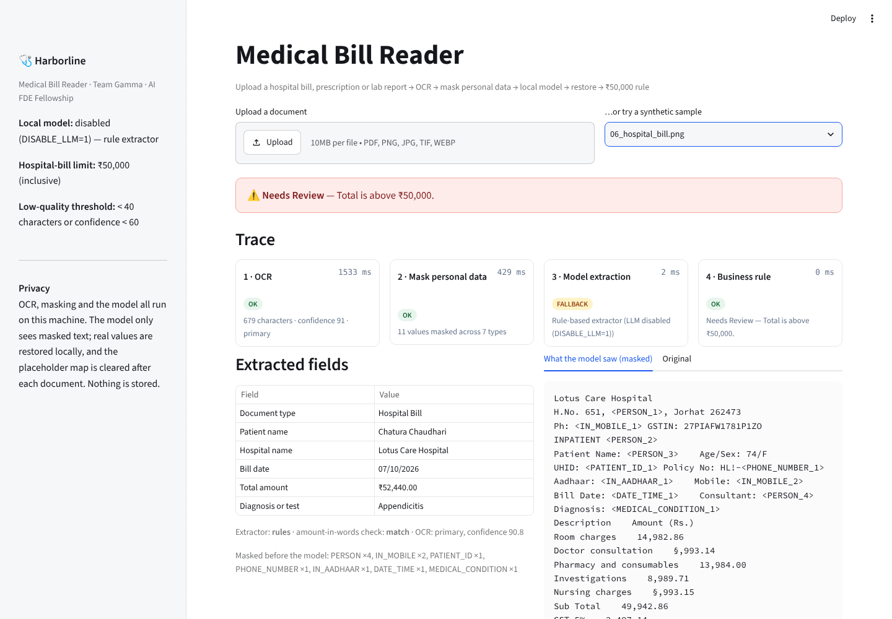

<div align="center">

# 🩺 Harborline Medical Bill Reader

**Read hospital bills, prescriptions and lab reports with OCR + a local AI model, mask personal and health data before the model sees anything, and apply the ₹50,000 hospital-bill limit.**
OCR, masking and the model all run **on your machine**. No document or personal data leaves it.

**Team Gamma · AI FDE Fellowship (Build Fast with AI) · Week 2: OCR Pipeline**



</div>

---

## Contents
1. [The problem](#1-the-problem)
2. [How it works](#2-how-it-works)
3. [Privacy design](#3-privacy-design)
4. [Business rules](#4-business-rules)
5. [Tech stack](#5-tech-stack)
6. [Run it locally](#6-run-it-locally)
7. [API](#7-api)
8. [Evaluation (20 documents)](#8-evaluation-20-documents)
9. [Tests](#9-tests)
10. [Configuration](#10-configuration)
11. [Project structure](#11-project-structure)
12. [Limitations and next steps](#12-limitations-and-next-steps)
13. [Team Gamma](#13-team-gamma)

---

## 1. The problem

Harborline Health Insurance receives scanned hospital bills, prescriptions and lab reports. A claims handler needs six fields from each one, and a clear decision on whether a hospital bill is within the **₹50,000** limit. The documents are full of personal and health data (names, Aadhaar, PAN, phone numbers, policy numbers, diagnoses), so **no personal data may reach a model**, and everything runs locally.

**Fields extracted:** Patient Name · Hospital Name · Bill Date · Total Amount · Diagnosis or Test · Document Type (Hospital Bill, Prescription or Lab Report)

The full one-page spec is in [`docs/Team_Gamma_Workflow.pdf`](docs/Team_Gamma_Workflow.pdf).

## 2. How it works

```mermaid
flowchart LR
    A[1 Document upload] --> B[2 File validation<br/>real type from bytes,<br/>size + page limits]
    B --> C[3 OCR<br/>Tesseract word boxes + confidence]
    C --> Q{Low quality?<br/>&lt;40 chars or<br/>confidence &lt;60}
    Q -- yes --> F[Fallback preprocessing<br/>upscale · adaptive threshold · deskew]
    F --> Q2{Still low?}
    Q2 -- yes --> MR[Flag for manual review]
    Q -- no --> D
    Q2 -- no --> D
    MR --> D[4 Detect and mask personal data<br/>Presidio + Indian recognizers<br/>→ &lt;PERSON_1&gt;, &lt;IN_AADHAAR_1&gt; …]
    D --> E[5 AI extraction on MASKED text<br/>Ollama · Qwen2.5 · JSON schema · temperature 0]
    E --> G[6 Restore real values locally<br/>from the in-memory placeholder map]
    G --> H[7 Business rules<br/>₹50,000 limit · amount-in-words check]
    H --> I[8 Final result<br/>+ trace, cleanup]
```



| Step | What happens | Code |
|---|---|---|
| 1–2 | Upload, then validate: the **real file type is read from the bytes** (a text file renamed `.pdf` is rejected), size ≤ 10 MB, PDF ≤ 5 pages, no password | `harborline/validation.py` |
| 3 | **OCR.** A born-digital PDF uses its text layer. Scans go through OpenCV (grayscale → denoise → Otsu) and Tesseract `image_to_data`, which gives word boxes and confidence. Wide gaps between words are kept as column breaks. | `harborline/ocr.py` |
| 3b | **Low-quality check.** Under 40 characters or mean confidence under 60 → a second pass with a 2× upscale, stronger denoise, adaptive threshold and deskew. If it is still low, the document is routed to manual review. | `harborline/ocr.py` |
| 4 | **Mask personal data** with Microsoft Presidio + spaCy and custom recognizers. Each value becomes a placeholder like `<PERSON_1>`; the same value always gets the same placeholder. | `harborline/pii.py` |
| 5 | **Extraction on masked text only.** Ollama + Qwen2.5 with a JSON schema and temperature 0. If Ollama isn't running, a deterministic rule extractor takes over, and the trace says so. The labelled grand total always beats a model guess. | `harborline/llm.py`, `extract_rules.py` |
| 6 | **Restore** real values from the placeholder map, locally | `harborline/pii.py` |
| 7 | **Rules:** ₹50,000 limit and amount-in-words check | `harborline/rules.py`, `amounts.py` |
| 8 | **Result** with a four-stage trace (`ocr`, `pii`, `llm`, `rule`); the placeholder map is cleared; nothing is stored | `harborline/pipeline.py` |

The Streamlit page and `POST /v1/extract` call the same `run()` function, so they **return the same JSON**. A test checks this.

## 3. Privacy design

- **The model never sees personal data.** Only masked text is sent. [`tests/test_llm_privacy.py`](tests/test_llm_privacy.py) runs a mock Ollama server, captures the exact request body, and asserts that no real name, Aadhaar number, date or diagnosis is in it.
- **Everything is local.** Tesseract, Presidio/spaCy and Ollama all run on the machine. Even Presidio's email check is switched to its offline domain list, so masking makes **no network calls**.
- **Masked entity types:**

| Type | Examples | Detector |
|---|---|---|
| `PERSON` | patient, doctor, "Referred by" | spaCy NER + label-aware recognizer (`Patient Name:`, `Consultant:`, `Dr.` …) |
| `IN_AADHAAR` | `4821 7733 9012` | custom pattern |
| `IN_PAN` | `ABCPM1234K` | custom pattern |
| `IN_MOBILE`, `PHONE_NUMBER` | `+91 98765 43210`, landlines | custom pattern + Presidio |
| `BANK_ACCOUNT` | `A/c No: 50100234567812` | label-aware recognizer |
| `POLICY_NUMBER`, `PATIENT_ID` | `Policy No: HLI-55821-09`, `UHID: SMH-2024-88123` | label-aware recognizers |
| `MEDICAL_CONDITION` | `Diagnosis: Dengue fever` + ~50 condition terms | label-aware recognizer + deny list |
| `DATE_TIME` | bill date, date of birth | spaCy + DOB recognizer (calendar dates only; "3 days" is left alone) |
| `EMAIL_ADDRESS`, `LOCATION` | | Presidio |

- **Not masked, on purpose:** money amounts (the rule needs them), the hospital name (not personal data), and form labels such as "INPATIENT FINAL BILL", "Complete Blood Count" and "Age/Sex".
- **Logs and spans contain no personal data.** OpenTelemetry spans `ocr`, `pii`, `llm` and `rule` carry only counts, durations, statuses and entity *types*.
- **Cleanup:** the upload is processed in memory and never written to disk by the app. The placeholder map is cleared after each document. The response's `cleanup` block reports this.

## 4. Business rules

| Condition | Result |
|---|---|
| Hospital bill of **₹50,000 or below** (exactly ₹50,000 included) | **Within Limit** |
| Hospital bill **above ₹50,000** | **Needs Review**: "Total is above ₹50,000." |
| Total unreadable, **or amount in words does not match the figures** | **Needs Review**: "Total could not be read." |
| Low-quality scan, even after the fallback pass | **Needs Review**: sent for manual review |
| Prescriptions and lab reports | **Not Applicable** (the fields are still extracted) |

- **Total used:** the **grand total / amount payable**, never a pre-tax subtotal, a GST line, a single line item or an advance. If the model picks a subtotal, it is overridden by the labelled grand total, and the trace notes it.
- **Amount in words:** parsed in Indian English (lakh, crore, paise) and cross-checked with `num2words(lang="en_IN")`.

## 5. Tech stack

| Technology / Library | Purpose | Where |
|---|---|---|
| **Python 3.11+** | Core language (tested on 3.11–3.13) | |
| **Streamlit** | Front end with the four-stage trace panel | `streamlit_app.py` |
| **FastAPI** + **python-multipart** | Backend: `POST /v1/extract` (multipart upload), `GET /health` | `api.py` |
| **Tesseract OCR** + **PyTesseract** | Text extraction, word boxes and confidence (`image_to_data`) | `harborline/ocr.py` |
| **PyMuPDF** | PDF text layer, page rendering, page-count checks | `ocr.py`, `validation.py` |
| **OpenCV** + **Pillow** | Image preprocessing (denoise, threshold, upscale, deskew) | `ocr.py` |
| **filetype** | Real file type from the bytes, not the extension | `validation.py` |
| **Microsoft Presidio** + **spaCy** (`en_core_web_lg` or `_sm`) | Detecting and masking sensitive information | `harborline/pii.py` |
| **Custom Presidio recognizers** | Aadhaar, PAN, Indian mobile, bank account, policy number, patient ID, diagnosis terms | `pii.py` |
| **Ollama** + **Qwen2.5** (3B or 7B) | Local AI extraction (JSON schema, temperature 0) | `harborline/llm.py` |
| **Pydantic** | Request/response and model-output validation | `harborline/schemas.py` |
| **num2words** | Comparing the amount in words with the figures | `harborline/amounts.py` |
| **OpenTelemetry** | Spans `ocr`, `pii`, `llm`, `rule`; logs without personal data | `harborline/telemetry.py` |
| **python-dotenv** | Config from the environment; `.env.example` has empty values | `harborline/config.py` |
| **Pytest** | 61 tests, especially the rule edge cases | `tests/` |
| **Pandas** + CSV | Evaluation sheet and the three accuracy numbers | `scripts/evaluate.py` |
| **ReportLab** + **Faker** (`en_IN`) | Synthetic documents, rasterized with noise, rotation and blur so OCR is really tested | `scripts/generate_samples.py` |
| **Git** + **GitHub** | Version control and collaboration | |

## 6. Run it locally

### 1. System tools
```bash
# macOS
brew install tesseract
brew install ollama            # or download from ollama.com

# Ubuntu / Debian
sudo apt install tesseract-ocr
curl -fsSL https://ollama.com/install.sh | sh
```

### 2. The local model
```bash
ollama serve                   # leave running (the macOS app starts it automatically)
ollama pull qwen2.5:3b         # ~2 GB; use qwen2.5:7b on a bigger machine for higher accuracy
```

### 3. Python
```bash
git clone https://github.com/AGSGreeshma/harborline-medical-claims.git
cd harborline-medical-claims
python3 -m venv .venv && source .venv/bin/activate
pip install -r requirements.txt
python -m spacy download en_core_web_sm      # or en_core_web_lg for better name detection
cp .env.example .env                         # optional: the defaults work
```

### 4. Run
```bash
streamlit run streamlit_app.py               # page:  http://localhost:8501
uvicorn api:app --reload --port 8000         # API:   http://localhost:8000/docs
```
The page has a **"try a synthetic sample"** picker with all 20 test documents. The sidebar shows whether the local model is **ready**. If Ollama isn't running, the app still works using the rule extractor, and the trace shows `FALLBACK`.

## 7. API

**`POST /v1/extract`**: upload one document and get the full result.

In Postman:
- **Method:** `POST`
- **URL:** `http://localhost:8000/v1/extract`
- **Body:** **form-data**, with key `file` (type **File**) set to a PDF, PNG, JPEG, TIFF or WEBP

Or with curl:
```bash
curl -X POST http://localhost:8000/v1/extract -F "file=@samples/docs/06_hospital_bill.png"
```

Response, captured from a real run with `DISABLE_LLM=1` (the same JSON the page shows; `masked_text` shortened here). With Ollama running, `extractor` is `"ollama"` and the `llm` stage shows `qwen2.5:3b · temperature 0 · JSON schema`.
```json
{
  "request_id": "773638f020b2",
  "filename": "06_hospital_bill.png",
  "fields": {
    "patient_name": "Chatura Chaudhari",
    "hospital_name": "Lotus Care Hospital",
    "bill_date": "07/10/2026",
    "total_amount": 52440.0,
    "diagnosis_or_test": "Appendicitis",
    "document_type": "Hospital Bill"
  },
  "result": {
    "decision": "Needs Review",
    "reason": "Total is above ₹50,000.",
    "limit": 50000.0,
    "total_used": 52440.0,
    "words_check": "match"
  },
  "quality": { "ocr_path": "primary", "confidence": 90.8, "characters": 679, "low_quality": false },
  "masked_text": "Lotus Care Hospital\nH.No. 651, <PERSON_1>, Jorhat 262473\nPh: <IN_MOBILE_1> …\nPatient Name: <PERSON_2>    Age …",
  "entities_masked": { "PERSON": 3, "IN_MOBILE": 2, "PATIENT_ID": 1, "PHONE_NUMBER": 1, "IN_AADHAAR": 1, "DATE_TIME": 1, "MEDICAL_CONDITION": 1 },
  "extractor": "rules",
  "trace": [
    { "stage": "ocr",  "status": "ok", "ms": 1438, "detail": "679 characters · confidence 91 · primary" },
    { "stage": "pii",  "status": "ok", "ms": 1309, "detail": "10 values masked across 7 types" },
    { "stage": "llm",  "status": "fallback", "ms": 2, "detail": "Rule-based extractor (LLM disabled (DISABLE_LLM=1))" },
    { "stage": "rule", "status": "ok", "ms": 0.3,  "detail": "Needs Review — Total is above ₹50,000." }
  ],
  "cleanup": { "upload_stored": false, "placeholder_map_cleared": true, "placeholders_cleared": 10 }
}
```
This document's subtotal (₹49,942.86) is under the limit, but its **grand total (₹52,440)** is over it, so the decision is Needs Review.

Errors: `400` with `{"detail": "..."}` for empty, oversized, password-protected, too-long or wrong-type files.
**`GET /health`** → `{"status": "ok", "ollama": "ready", "model": "qwen2.5:3b", "bill_limit": 50000}`

## 8. Evaluation (20 documents)

`samples/docs/` holds **20 synthetic documents**: 10 hospital bills, 5 prescriptions and 5 lab reports, in PNG, JPEG and scanned-PDF form, with noise, slight rotation and blur. All people are fictional (Faker `en_IN`). The ground truth is in `samples/ground_truth.csv`. The bills are built around the rule's edge cases:

| # | Case | Expected |
|---|---|---|
| 01 | ₹18,450 | Within Limit |
| 02 | ₹49,999, one rupee under | Within Limit |
| 03 | **exactly ₹50,000** | **Within Limit** (inclusive) |
| 04 | ₹50,001, scanned PDF | Needs Review |
| 05 | ₹1,48,825 (lakh scale) | Needs Review |
| 06 | **subtotal ₹49,942.86 under, grand total ₹52,440 over** | **Needs Review** |
| 07 | ₹48,300 with GST lines | Within Limit |
| 08 | **₹45,000, but the words say "Forty Thousand"** | **Needs Review** |
| 09 | ₹62,500 with an advance paid | Needs Review (grand total used) |
| 10 | ₹32,750, **heavily degraded scan** | Within Limit |

```bash
python scripts/generate_samples.py     # regenerate the set (seeded, reproducible)
python scripts/evaluate.py             # -> eval/results.csv (per document) + eval/summary.json
```

**Results:**

| Metric | Rule extractor (no model) | Ollama + Qwen2.5 |
|---|---|---|
| **Field accuracy** (6 fields × 20 docs) | **99.2%** | run `python scripts/evaluate.py` with Ollama running |
| **Document-type accuracy** | **100%** | |
| **Decision accuracy** | **100%** | |
| Mean time per document | 1.8 s | |

**One failure, explained:** on `08_hospital_bill.png`, Tesseract read the patient name "Elijah" as **"Efijah"**. The name was still detected and masked, and the decision was still correct, but the extracted name is wrong. This is an OCR error, not an extraction error.

**Honest caveat:** the rule extractor scores high partly because these synthetic documents share a layout. Real bills vary much more, and that is what the local model is for. The evaluation script measures both.

## 9. Tests

```bash
pytest          # 61 tests, ~25 s, no Ollama needed (the model path uses a mock server)
```

| File | What it proves |
|---|---|
| `test_rules.py` | Every rule edge case: ₹49,999.99 / **₹50,000 exactly** / ₹50,000.01, unreadable totals, words mismatch, prescriptions and lab reports, low quality, unknown type, custom limit |
| `test_amounts.py` | Indian number formats (₹1,23,456.50, Rs. 48,825/-), words with lakh/crore/paise, typo detection |
| `test_extract.py` | **Grand total beats subtotal, GST, advance and balance**; doc-type classification; label boundaries |
| `test_pii.py` | Aadhaar, PAN, mobile, email, bank account, policy, UHID, names, DOB and diagnosis are all masked; amounts, the hospital name and labels are not; consistent placeholders; restore round trip |
| `test_llm_privacy.py` | **Only masked text reaches the model**; placeholders are restored; a model-picked subtotal is overridden; fallback when Ollama is down |
| `test_validation.py` | Type from bytes (a fake `.pdf` is rejected), empty / size / page limits |
| `test_api_and_e2e.py` | Real OCR end to end on the edge-case documents; **API JSON == page JSON**; 400 on bad files; `/health` |

## 10. Configuration

All settings are optional; see [`.env.example`](.env.example).

| Variable | Default | Purpose |
|---|---|---|
| `OLLAMA_URL` | `http://localhost:11434` | Local Ollama server |
| `OLLAMA_MODEL` | `qwen2.5:3b` | `qwen2.5:7b` for higher accuracy |
| `OLLAMA_TIMEOUT` | `120` | Seconds |
| `DISABLE_LLM` | `0` | `1` = rule extractor only |
| `SPACY_MODEL` | `en_core_web_lg` if installed, else `_sm` | Presidio's NLP model |
| `BILL_LIMIT` | `50000` | Hospital-bill limit (inclusive) |
| `MIN_OCR_CHARS` / `MIN_OCR_CONFIDENCE` | `40` / `60` | Low-quality thresholds |
| `MAX_UPLOAD_MB` / `MAX_PAGES` | `10` / `5` | Upload limits |
| `OTEL_CONSOLE` | `0` | `1` = print OpenTelemetry spans to the console |

## 11. Project structure

```
api.py                        FastAPI: POST /v1/extract, GET /health
streamlit_app.py              Streamlit page with the four-stage trace
harborline/
  pipeline.py                 the 8-step pipeline; returns ExtractResponse
  validation.py               file type from bytes, size and page limits
  ocr.py                      Tesseract + OpenCV, low-quality check, fallback pass
  pii.py                      Presidio + Indian recognizers, mask / restore
  llm.py                      Ollama client (JSON schema, temperature 0)
  extract_rules.py            deterministic extractor + grand-total finder
  amounts.py                  rupee parsing, words <-> numbers, num2words check
  rules.py                    the ₹50,000 business rules
  schemas.py                  Pydantic models (the JSON contract)
  telemetry.py                OpenTelemetry spans and PII-free logging
  config.py                   settings from .env
scripts/
  generate_samples.py         20 synthetic documents + ground truth
  evaluate.py                 three accuracy numbers -> eval/
samples/docs/                 the 20 test documents (fictional data)
samples/ground_truth.csv
eval/summary.json             latest evaluation summary
tests/                        61 pytest tests
docs/                         workflow PDF and screenshots
```

## 12. Limitations and next steps

**Limitations**
- **Handwritten prescriptions** are beyond Tesseract. They would go to manual review via the low-quality check, or need a handwriting model.
- Masking is **pattern- and NER-based**. An unusual name format that spaCy misses and that has no label in front of it can slip through. `en_core_web_lg` reduces this.
- Multi-page bills are read in full, but **the totals are expected on the last page**.
- The evaluation set is synthetic and shares one layout per document type.

**Next steps**
- [ ] Evaluate on real, anonymised bills from Harborline
- [ ] A table-aware pass (Tesseract layout analysis or a layout model) for itemised bills
- [ ] A handwriting OCR fallback for prescriptions
- [ ] A reviewer queue for "Needs Review" documents, with one-click corrections fed back into the evaluation set

## 13. Team Gamma

| Member | Contribution |
|---|---|
| **Greeshma** | Co-wrote the project workflow, flowchart and tech-stack document ([`docs/Team_Gamma_Workflow.pdf`](docs/Team_Gamma_Workflow.pdf)); set up the repository |
| **Radhika Asati** | Co-wrote the project workflow, flowchart and tech-stack document |
| **Asmita Roy** | Built the end-to-end implementation: validation, OCR with the low-quality fallback, Presidio masking with the Indian recognizers, the Ollama extraction and local restore, the business rules, the FastAPI and Streamlit apps, the synthetic dataset, the evaluation script and the test suite |

<sub>AI FDE Fellowship by Build Fast with AI · Harborline Health Insurance is a fictional client created for the fellowship · all people in the sample documents are fictional.</sub>
